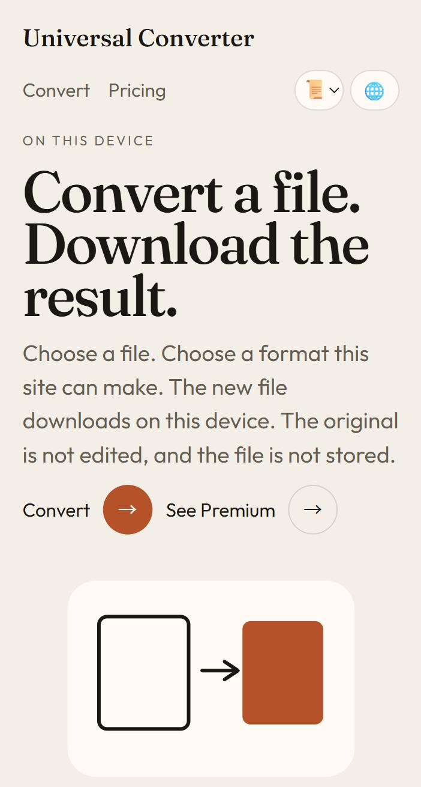

# Universal Converter

**Convert a file. Download the result. Right on your device — the original stays untouched and nothing is stored.**

[Convert a file](https://universalconverter.aplusz.app/en/)

---

## Three steps

1. Choose your file
2. Choose a format the site can make
3. The new file downloads on your device

## What it converts

- **Images**: PNG, JPG, WEBP, GIF or BMP in — PNG, JPG, WEBP, BMP or a one-page PDF out
- **Text**: TXT, Markdown, HTML, CSV, TSV or JSON — tables stay tables
- **Audio**: any file your browser plays, out as WAV

## Pricing

- **Free**: 3 conversions a month
- **Premium — $0.99 a month**: unlimited conversions, paid with PayPal, cancel anytime

Available in **20 languages**, installable as an app.

**https://universalconverter.aplusz.app/en/**

Made by **Verge Heights** · contact@aplusz.app
